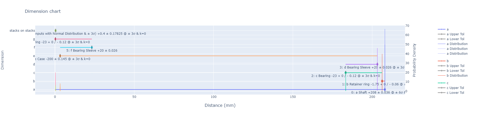
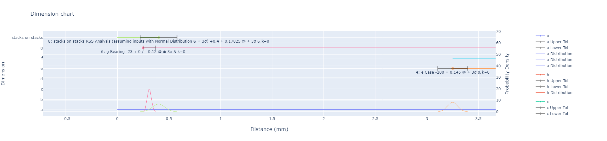

# dimstack

Python library for 1D statistical tolerancing analysis and design.

PyPI: https://pypi.org/project/dimstack/

Docs: https://phcreery.github.io/dimstack/


## Example (MIT Calc Demonstration Analysis)

```python
import dimstack as ds

ds.display.mode(ds.display.DisplayMode.RICH)

k = 0.25
target_process_sigma = 3
std_dev = 0.036 / target_process_sigma
m1 = ds.Dim(
    nom=208,
    tol=ds.tol.Bilateral.symmetric(0.036),
    name="a",
    desc="Shaft",
).review(
    distribution=ds.dist.Normal(208 + k * target_process_sigma * std_dev, std_dev),
)
m2 = (
    ds.Dim(
        nom=-1.75,
        tol=ds.tol.Bilateral.unequal(0, 0.06),
        name="b",
        desc="Retainer ring",
    )
    .review()
    .assume_normal_dist(3)
)

m3 = (
    ds.Dim(
        nom=-23,
        tol=ds.tol.Bilateral.unequal(0, 0.12),
        name="c",
        desc="Bearing",
    )
    .review()
    .assume_normal_dist(3)
)
m4 = (
    ds.Dim(
        nom=20,
        tol=ds.tol.Bilateral.symmetric(0.026),
        name="d",
        desc="Bearing Sleeve",
    )
    .review()
    .assume_normal_dist(3)
)
m5 = (
    ds.Dim(
        nom=-200,
        tol=ds.tol.Bilateral.symmetric(0.145),
        name="e",
        desc="Case",
    )
    .review()
    .assume_normal_dist(3)
)
m6 = (
    ds.Dim(
        nom=20,
        tol=ds.tol.Bilateral.symmetric(0.026),
        name="f",
        desc="Bearing Sleeve",
    )
    .review()
    .assume_normal_dist(3)
)
m7 = (
    ds.Dim(
        nom=-23,
        tol=ds.tol.Bilateral.unequal(0, 0.12),
        name="g",
        desc="Bearing",
    )
    .review()
    .assume_normal_dist(3)
)
items = [m1, m2, m3, m4, m5, m6, m7]

stack = ds.stack.ReviewedStack(name="stacks on stacks", dims=items)

stack.to_basic_stack().show()
stack.show()

ds.calc.Closed(stack).show()
ds.calc.WC(stack).show()
ds.calc.RSS(stack).show()
ds.calc.MRSS(stack).show()
designed_for = ds.calc.SixSigma(stack, at=4.5)
designed_for.show()

spec = ds.dim.Requirement(LL=0.05, UL=0.8, name="stack spec", desc="", distribution=designed_for.distribution)
spec.show()

ds.plot.StackPlot().add(stack).add(ds.calc.RSS(stack)).show()

```

Returns:

```

                            DIMENSION STACK: stacks on stacks                            
┏━━━━━━┳━━━━━━━━━━━━━━━━┳━━━┳━━━━━━━┳━━━━━━━━━━━━━━━━┳━━━━━━━━━━━┳━━━━━━━━━━━━━━━━━━━━━━┓
┃ Name ┃ Desc.          ┃ ± ┃ Nom.  ┃ Tol.           ┃ Sens. (a) ┃ Abs. Bounds          ┃
┡━━━━━━╇━━━━━━━━━━━━━━━━╇━━━╇━━━━━━━╇━━━━━━━━━━━━━━━━╇━━━━━━━━━━━╇━━━━━━━━━━━━━━━━━━━━━━┩
│ a    │ Shaft          │ + │ 208.0 │ ± 0.036        │ 1         │ [207.964, 208.036]   │
│ b    │ Retainer ring  │ - │ 1.75  │ +0.06 / +0     │ 1         │ [-1.81, -1.75]       │
│ c    │ Bearing        │ - │ 23.0  │ +0.12 / +0     │ 1         │ [-23.12, -23]        │
│ d    │ Bearing Sleeve │ + │ 20.0  │ ± 0.026        │ 1         │ [19.974, 20.026]     │
│ e    │ Case           │ - │ 200.0 │ ± 0.145        │ 1         │ [-200.145, -199.855] │
│ f    │ Bearing Sleeve │ + │ 20.0  │ ± 0.026        │ 1         │ [19.974, 20.026]     │
│ g    │ Bearing        │ - │ 23.0  │ +0.12 / +0     │ 1         │ [-23.12, -23]        │
└──────┴────────────────┴───┴───────┴────────────────┴───────────┴──────────────────────┘

                                                                 REVIEWED DIMENSION STACK: stacks on stacks                                                                 
┏━━━━━━━━━━━━━━━━━━━━━━━━━━━━━━━━━━━━━━━━━━━━━━━━━━━┳━━━━━━━━━━━━━━━━━━━━━━━━━━━━━━━━━━┳━━━━━━━━━━━┳━━━━━┳━━━━━━┳━━━━━━━━┳━━━━━━━━━┳━━━━━━━━━━━━┳━━━━━━━━━━━━━┳━━━━━━━━━━━━┓
┃ Dim.                                              ┃ Dist.                            ┃ Shift (k) ┃ C_p ┃ C_pk ┃ μ_eff  ┃ σ_eff   ┃ Eff. Sigma ┃ Yield Prob. ┃ Reject PPM ┃
┡━━━━━━━━━━━━━━━━━━━━━━━━━━━━━━━━━━━━━━━━━━━━━━━━━━━╇━━━━━━━━━━━━━━━━━━━━━━━━━━━━━━━━━━╇━━━━━━━━━━━╇━━━━━╇━━━━━━╇━━━━━━━━╇━━━━━━━━━╇━━━━━━━━━━━━╇━━━━━━━━━━━━━╇━━━━━━━━━━━━┩
│ a Shaft                        +   208 ± 0.036    │ Normal Dist. μ=208.009, σ=0.012  │ 0.25      │ 1.0 │ 0.75 │ 208.0  │ 0.016   │ ± 2.25σ    │ 98.76871101 │ 12312.89   │
│ b Retainer ring                -  1.75 +0.06 / +0 │ Normal Dist. μ=-1.78, σ=0.01     │ 0.0       │ 1.0 │ 1.0  │ -1.78  │ 0.01    │ ± 3.0σ     │ 99.73002039 │ 2699.8     │
│ c Bearing                      -    23 +0.12 / +0 │ Normal Dist. μ=-23.06, σ=0.02    │ 0.0       │ 1.0 │ 1.0  │ -23.06 │ 0.02    │ ± 3.0σ     │ 99.73002039 │ 2699.8     │
│ d Bearing Sleeve               +    20 ± 0.026    │ Normal Dist. μ=20.0, σ=0.00867   │ 0.0       │ 1.0 │ 1.0  │ 20.0   │ 0.00867 │ ± 3.0σ     │ 99.73002039 │ 2699.8     │
│ e Case                         -   200 ± 0.145    │ Normal Dist. μ=-200.0, σ=0.04833 │ 0.0       │ 1.0 │ 1.0  │ -200.0 │ 0.04833 │ ± 3.0σ     │ 99.73002039 │ 2699.8     │
│ f Bearing Sleeve               +    20 ± 0.026    │ Normal Dist. μ=20.0, σ=0.00867   │ 0.0       │ 1.0 │ 1.0  │ 20.0   │ 0.00867 │ ± 3.0σ     │ 99.73002039 │ 2699.8     │
│ g Bearing                      -    23 +0.12 / +0 │ Normal Dist. μ=-23.06, σ=0.02    │ 0.0       │ 1.0 │ 1.0  │ -23.06 │ 0.02    │ ± 3.0σ     │ 99.73002039 │ 2699.8     │
└───────────────────────────────────────────────────┴──────────────────────────────────┴───────────┴─────┴──────┴────────┴─────────┴────────────┴─────────────┴────────────┘

                              DIMENSION: Closed Analysis -- stacks on stacks                              
┏━━━━━━━━━━━━━━━━━━━━━━━━━━━━━━━━━━━━━┳━━━━━━━┳━━━┳━━━━━━┳━━━━━━━━━━━━━━━━━┳━━━━━━━━━━━┳━━━━━━━━━━━━━━━━━┓
┃ Name                                ┃ Desc. ┃ ± ┃ Nom. ┃ Tol.            ┃ Sens. (a) ┃ Abs. Bounds     ┃
┡━━━━━━━━━━━━━━━━━━━━━━━━━━━━━━━━━━━━━╇━━━━━━━╇━━━╇━━━━━━╇━━━━━━━━━━━━━━━━━╇━━━━━━━━━━━╇━━━━━━━━━━━━━━━━━┩
│ Closed Analysis -- stacks on stacks │       │ + │ 0.25 │ +0.233 / -0.533 │ 1         │ [-0.283, 0.483] │
└─────────────────────────────────────┴───────┴───┴──────┴─────────────────┴───────────┴─────────────────┘

                             DIMENSION: WC Analysis -- stacks on stacks                              
┏━━━━━━━━━━━━━━━━━━━━━━━━━━━━━━━━━┳━━━━━━━┳━━━┳━━━━━━┳━━━━━━━━━━━━━━━━┳━━━━━━━━━━━┳━━━━━━━━━━━━━━━━━┓
┃ Name                            ┃ Desc. ┃ ± ┃ Nom. ┃ Tol.           ┃ Sens. (a) ┃ Abs. Bounds     ┃
┡━━━━━━━━━━━━━━━━━━━━━━━━━━━━━━━━━╇━━━━━━━╇━━━╇━━━━━━╇━━━━━━━━━━━━━━━━╇━━━━━━━━━━━╇━━━━━━━━━━━━━━━━━┩
│ WC Analysis -- stacks on stacks │       │ + │ 0.1  │ ± 0.383        │ 1         │ [-0.283, 0.483] │
└─────────────────────────────────┴───────┴───┴──────┴────────────────┴───────────┴─────────────────┘

                                                     DIMENSION: RSS Analysis -- stacks on stacks                                                     
┏━━━━━━━━━━━━━━━━━━━━━━━━━━━━━━━━━━┳━━━━━━━━━━━━━━━━━━━━━━━━━━━━━━━━━━━━━━━━━━━━━━━━━━┳━━━┳━━━━━━┳━━━━━━━━━━━━━━━━┳━━━━━━━━━━━┳━━━━━━━━━━━━━━━━━━━━━┓
┃ Name                             ┃ Desc.                                            ┃ ± ┃ Nom. ┃ Tol.           ┃ Sens. (a) ┃ Abs. Bounds         ┃
┡━━━━━━━━━━━━━━━━━━━━━━━━━━━━━━━━━━╇━━━━━━━━━━━━━━━━━━━━━━━━━━━━━━━━━━━━━━━━━━━━━━━━━━╇━━━╇━━━━━━╇━━━━━━━━━━━━━━━━╇━━━━━━━━━━━╇━━━━━━━━━━━━━━━━━━━━━┩
│ RSS Analysis -- stacks on stacks │ (assuming inputs with Normal Dist. & uniform SD) │ + │ 0.1  │ ± 0.17825      │ 1         │ [-0.07825, 0.27825] │
└──────────────────────────────────┴──────────────────────────────────────────────────┴───┴──────┴────────────────┴───────────┴─────────────────────┘

                                                     DIMENSION: MRSS Analysis -- stacks on stacks                                                     
┏━━━━━━━━━━━━━━━━━━━━━━━━━━━━━━━━━━━┳━━━━━━━━━━━━━━━━━━━━━━━━━━━━━━━━━━━━━━━━━━━━━━━━━━┳━━━┳━━━━━━┳━━━━━━━━━━━━━━━━┳━━━━━━━━━━━┳━━━━━━━━━━━━━━━━━━━━━┓
┃ Name                              ┃ Desc.                                            ┃ ± ┃ Nom. ┃ Tol.           ┃ Sens. (a) ┃ Abs. Bounds         ┃
┡━━━━━━━━━━━━━━━━━━━━━━━━━━━━━━━━━━━╇━━━━━━━━━━━━━━━━━━━━━━━━━━━━━━━━━━━━━━━━━━━━━━━━━━╇━━━╇━━━━━━╇━━━━━━━━━━━━━━━━╇━━━━━━━━━━━╇━━━━━━━━━━━━━━━━━━━━━┩
│ MRSS Analysis -- stacks on stacks │ (assuming inputs with Normal Dist. & uniform SD) │ + │ 0.1  │ ± 0.24046      │ 1         │ [-0.14046, 0.34046] │
└───────────────────────────────────┴──────────────────────────────────────────────────┴───┴──────┴────────────────┴───────────┴─────────────────────┘

                                                      REVIEWED DIMENSION: '6 Sigma' Analysis -- stacks on stacks                                                       
┏━━━━━━━━━━━━━━━━━━━━━━━━━━━━━━━━━━━━━━━━━━━━━━━━━━┳━━━━━━━━━━━━━━━━━━━━━━━━━━━━━━━┳━━━━━━━━━━━┳━━━━━┳━━━━━━┳━━━━━━━┳━━━━━━━━━┳━━━━━━━━━━━━┳━━━━━━━━━━━━━┳━━━━━━━━━━━━┓
┃ Dim.                                             ┃ Dist.                         ┃ Shift (k) ┃ C_p ┃ C_pk ┃ μ_eff ┃ σ_eff   ┃ Eff. Sigma ┃ Yield Prob. ┃ Reject PPM ┃
┡━━━━━━━━━━━━━━━━━━━━━━━━━━━━━━━━━━━━━━━━━━━━━━━━━━╇━━━━━━━━━━━━━━━━━━━━━━━━━━━━━━━╇━━━━━━━━━━━╇━━━━━╇━━━━━━╇━━━━━━━╇━━━━━━━━━╇━━━━━━━━━━━━╇━━━━━━━━━━━━━╇━━━━━━━━━━━━┩
│ '6 Sigma' Analysis --...       +   0.1 ± 0.27158 │ Normal Dist. μ=0.1, σ=0.06035 │ 0.0       │ 1.5 │ 1.5  │ 0.1   │ 0.06035 │ ± 4.5σ     │ 99.99932047 │ 6.8        │
└──────────────────────────────────────────────────┴───────────────────────────────┴───────────┴─────┴──────┴───────┴─────────┴────────────┴─────────────┴────────────┘

                                         REQUIREMENT: stack spec                                         
┏━━━━━━━━━━━━┳━━━━━━━┳━━━━━━━━━━━━━━━━━━━━━━━━━━━━━━━┳━━━━━━━━┳━━━━━━━━━━━━━━┳━━━━━━━━━━━━━┳━━━━━━━━━━━━┓
┃ Name       ┃ Desc. ┃ Distribution                  ┃ Median ┃ Spec. Limits ┃ Yield Prob. ┃ Reject PPM ┃
┡━━━━━━━━━━━━╇━━━━━━━╇━━━━━━━━━━━━━━━━━━━━━━━━━━━━━━━╇━━━━━━━━╇━━━━━━━━━━━━━━╇━━━━━━━━━━━━━╇━━━━━━━━━━━━┩
│ stack spec │       │ Normal Dist. μ=0.1, σ=0.06035 │ 0.425  │ [0.05, 0.8]  │ 79.62996326 │ 203700.37  │
└────────────┴───────┴───────────────────────────────┴────────┴──────────────┴─────────────┴────────────┘

```




## Usage

dimstack works great as a library in a python script, in REPL, or in JupyterLab.

### and Notebook setup

```
%pip install -q dimstack
```

## Development

### Testing

```
uv run python -m unittest
```

### Documenting

```
python -m mkdocs build
python -m mkdocs serve
python -m mkdocs gh-deploy
```

```
uv run mkdocs build
uv run mkdocs serve
uv run mkdocs gh-deploy
```

### Deploying

First bump version in pyproject.toml, then

```
uv build
uv publish
```

# Acknowledgements

- https://d2t1xqejof9utc.cloudfront.net/files/147765/Dimensioning%20and%20Tolerancing%20Handbook.pdf?1541238602
- http://www.newconceptzdesign.com/stackups/
  - https://web.archive.org/web/20221206235926/http://www.newconceptzdesign.com/tutorial/Tutorial-My_first_stackup.html
- https://github.com/slightlynybbled/tol-stack
- https://www.mitcalc.com/doc/tolanalysis1d/help/en/tolanalysis1d.htm
- https://clas.iusb.edu/math-compsci/_prior-thesis/YFeng_thesis.pdf
- https://ris.utwente.nl/ws/portalfiles/portal/6632975/Salomons96computer1.pdf
- https://ris.utwente.nl/ws/files/6632926/Salomons96computer2.pdf
